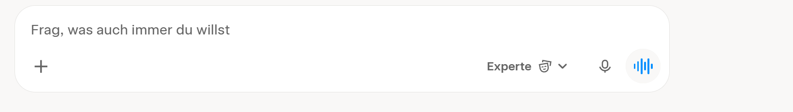

# WORK – Chat Uploads, Voice & Dashboard als Connector

**Stand:** 26.10.2026  
**Ziel:**  
1. Warum der KI-Chat keine Dokumente/Fotos/Screenshots und keine Voice-Eingabe akzeptiert und wie man das fixt.  
2. Dashboard als Connector für externe Agents (Grok Bot, Claude Code etc.).

---

## 1. Chat Uploads (Dokumente, Fotos, Screenshots) + Voice

### Aktueller Stand
Der KI-Chat akzeptiert nur Text. Der User kann keine Dateien, Bilder, Screenshots oder Sprache einfügen.

### Warum es nicht geht
- Frontend hat keinen File-Upload und keinen Voice-Input.
- Backend hat keinen Endpoint für Multimodal-Input oder Speech-to-Text.
- LLM-Call (Grok) wird nur mit Text aufgerufen.

### Design-Beispiel (Grok Interface)



*Beispiel: Plus-Button für Uploads, Mikrofon und Voice-Wave für Spracheingabe.*

### Implementierungsvorschlag

| Schritt | Beschreibung | Aufwand |
|---------|--------------|---------|
| **Frontend Upload** | Drag & Drop oder Button für Upload (PDF, PNG, JPG). | 4–6 h |
| **Frontend Voice** | Mikrofon-Button, Aufnahme, Send an Backend. | 3–4 h |
| **Backend Upload** | Endpoint `/chat/upload` speichert Datei und extrahiert Text (PDF) oder sendet Bild an Vision-Modell. | 6–8 h |
| **Backend Voice** | Endpoint `/chat/voice` sendet Audio an Whisper (OpenRouter) und gibt Transkript zurück. | 3–4 h |
| **LLM-Call** | Multimodal: Text + Bild-URL oder extrahierter Text + Voice-Transkript wird dem Prompt mitgegeben. | 2–3 h |
| **Caching** | Uploads und Voice-Transkripte werden pro Chat gespeichert. | 2–3 h |
| **Gesamt** | | **~20–28 h** |

**Unterstützte Formate (Vorschlag):**
- PDF (Text-Extraktion)
- PNG / JPG (Vision)
- Voice (Whisper via OpenRouter)
- Optional: Excel / CSV (Tabellen-Extraktion)

---

## 2. Dashboard als Connector (kein Skill)

### Ziel
Externe Agents (Grok Bot, Claude Code, Cursor etc.) können über einen Account die quantitative Scoring-Logik des Dashboards nutzen.

### Unterschied Skill vs. Connector

| | Skill | Connector |
|---|-------|-----------|
| **Wo** | Im Agent-Repo | Externer Service |
| **Auth** | Keine | Account + API-Key |
| **Daten** | Lokal | Live aus dem Dashboard |
| **Beispiel** | Lokales Python-Skript | API-Call an `/scoring/NVO` |

### Architektur

```
Agent (Grok Bot / Claude Code)
    ↓
API-Key (User-Account)
    ↓
Dashboard-Backend (/api/scoring/:symbol)
    ↓
Scoring-Logik + Analyse-Daten
    ↓
JSON-Response an Agent
```

### Endpoints (Vorschlag)

| Endpoint | Funktion |
|----------|----------|
| `GET /api/scoring/:symbol` | Ampel, Gates, Score, Top-Treiber |
| `GET /api/analysis/:symbol` | Vollständige Analyse (DCF, Technical, Moat) |
| `POST /api/podcast/:symbol` | Podcast generieren (optional) |

### Auth
- User erstellt API-Key im Dashboard.
- Agent sendet Key im Header.
- Rate-Limits pro Key.

### Aufwand

| Schritt | Aufwand |
|---------|---------|
| API-Endpoints bauen | 8–10 h |
| Auth + API-Key-System | 6–8 h |
| Dokumentation für Agents | 3–4 h |
| **Gesamt** | **~17–22 h** |

---

## Priorisierung

| Priorität | Feature | Aufwand | Nutzen |
|-----------|---------|---------|--------|
| **1** | Chat Uploads + Voice | 20–28 h | User kann Screenshots/PDFs und Sprache einfügen |
| **2** | Connector | 17–22 h | Agents können Scoring nutzen |

**Gesamt:** ~37–50 h.
