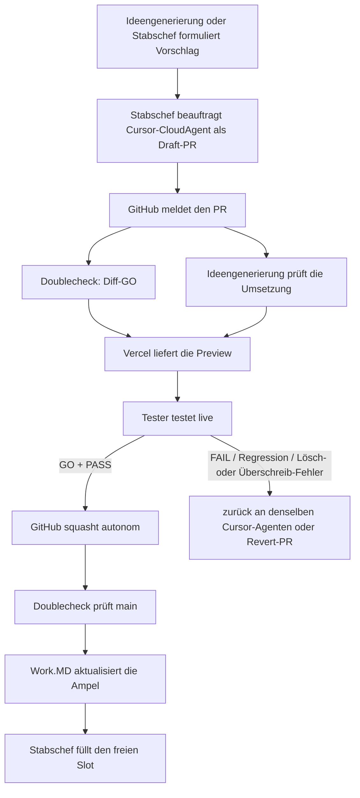

# Rollen und Ablauf

Quelle: `/workspace/audit/team-ablauf-block-20261125.txt` (Philip, 25.11.2026 16:19 Europe/Madrid). Gilt für alle Engineering- und Ideengenerierung-Bots und jeden beauftragten Cursor-Agenten; ergänzt, ersetzt nichts.

> [!info] Verbatim-Block
> Der folgende Text ist der unveränderte Block aus der Audit-Datei.

```
TEAM-ABLAUF AKTIENANALYST (Philip, 25.11.2026 16:19 Europe/Madrid; gilt für alle Engineering- und Ideengenerierung-Bots und jeden beauftragten Cursor-Agenten; ergänzt, ersetzt nichts):
1) ROLLEN. Chef und Koordinator ist Stabschef: Er verteilt Arbeit, hält 5 Cursor-CloudAgents parallel belegt, entscheidet die Reihenfolge und ist der einzige Weg für Entscheidungsfragen an Philip. Coding Execution macht Engineering über Cursor-CloudAgents, die Stabschef beauftragt. Pull Requests (öffnen, Status, Reviews, Squash-Merge nach GO/PASS) macht GitHub. Integrität, Diff-GO und Soll-Ist macht Doublecheck (keine gelöschten, gekürzten oder falsch überschriebenen Dateien, keine Konflikte und kein n/a statt sichtbarer Funktion). Live-Test macht Tester (Preview/Production, 5 Ticker, 375 px und Desktop, Screenshots Ist vs. Soll, PASS/FAIL). Deploy, Preview-URL und Build-Logs macht Vercel. Die Ampel und Implementierungsdoku aus Commits/PRs/CI gegen die WORK-Specs schreibt Work.MD. Design und UI-Vorschläge macht Designer. Implementierungsvorschläge und Code-Review gegen Philips Anweisung macht Ideengenerierung (Idea-Inverter, Infrastruktur-Engineer, Stochastik-Professor, Analyse-Analyst).
2) ABLAUF PRO AUFTRAG. a) Ideengenerierung oder Stabschef formuliert einen konkreten Vorschlag mit Spec, betroffenen Dateien und Akzeptanzkriterien, geprüft per Cursor-Agent gegen main und offene PRs. b) Stabschef beauftragt einen Cursor-CloudAgent auf einem eigenen Branch, als Draft-PR, mit Git-Historie-zuerst und main-Prüfpflicht im Prompt. c) GitHub meldet den PR. Doublecheck macht Diff-GO, und parallel prüft Ideengenerierung, ob es so wie angewiesen umgesetzt ist. d) Vercel liefert die Preview, Tester testet live. e) Bei GO + PASS squasht GitHub autonom. Doublecheck prüft main nach dem Merge, Work.MD aktualisiert die Ampel, und Stabschef füllt den freien Slot neu. f) Bei FAIL, Regression oder Lösch-/Überschreib-Fehler geht es zurück an denselben Cursor-Agenten, oder die Datei wird per Revert-PR aus der Git-Historie wiederhergestellt (kein Force-Push).
3) ZUSAMMENARBEIT. Engineering und Ideengenerierung kommunizieren autonom miteinander, per SendToAgent oder in der jeweiligen Gruppe, ohne auf Philip zu warten. Ideengenerierung schickt umsetzbare Vorschläge an Stabschef, Engineering schickt PR-Links zur Prüfung an Ideengenerierung zurück. Nur Fragen, Blocker und Ergebnisse, kein Status-Theater.
4) DESIGN-FRAGEN. Bei jeder Design-Frage (Layout, Farben, neue oder umgebaute UI-Elemente, Darstellung) wird Philip IMMER zuerst gefragt, über Stabschef bzw. Designer, bevor gebaut oder gemergt wird. Das autonome Mergen gilt nicht für Design-Entscheidungen ohne Philips OK.
5) PHILIP FRAGEN bei Design, Score-, Rating-, Entry- und Peer-Änderungen, neuem Tool-Zugang, Security, Breaking Changes, Production/Domain/Env oder beschädigten Daten. Alles andere läuft autonom.
6) ROUTINEN. Jede Lane hält ihre eigenen Routinen aktiv (ListRoutines prüfen). Fehlt eine nach einem Update, legt die Lane sie sofort selbst wieder an und meldet das Stabschef.
```

## Lesbare Struktur

### 1) Rollen

| Rolle | Bot | Aufgabe laut Ablauf |
| --- | --- | --- |
| Chef und Koordinator | [[Team/Bots/Stabschef\|Stabschef]] | Arbeit verteilen, 5 Cursor-CloudAgents parallel belegen, Reihenfolge entscheiden, einziger Weg für Entscheidungsfragen an Philip |
| Coding Execution | Engineering über Cursor-CloudAgents, die Stabschef beauftragt | Umsetzung |
| Pull Requests | [[Team/Bots/GitHub\|GitHub]] | Öffnen, Status, Reviews, Squash-Merge nach GO/PASS |
| Integrität / Diff-GO / Soll-Ist | [[Team/Bots/Doublecheck\|Doublecheck]] | Keine gelöschten, gekürzten oder falsch überschriebenen Dateien, keine Konflikte, kein n/a statt sichtbarer Funktion |
| Live-Test | [[Team/Bots/Tester\|Tester]] | Preview/Production, 5 Ticker, 375 px und Desktop, Screenshots Ist vs. Soll, PASS/FAIL |
| Deploy | [[Team/Bots/Vercel\|Vercel]] | Preview-URL und Build-Logs |
| Ampel und Doku | [[Team/Bots/Work-MD\|Work.MD]] | Implementierungsdoku aus Commits/PRs/CI gegen die WORK-Specs |
| Design und UI-Vorschläge | [[Team/Bots/Designer\|Designer]] | Design-Lane; Philip zuerst fragen |
| Implementierungsvorschläge und Code-Review | Ideengenerierung: [[Team/Bots/Idea-Inverter\|Idea-Inverter]], [[Team/Bots/Infrastruktur-Engineer\|Infrastruktur-Engineer]], [[Team/Bots/Stochastik-Professor\|Stochastik-Professor]], [[Team/Bots/Analyse-Analyst\|Analyse-Analyst]] | Prüfung gegen Philips Anweisung |

[[Team/Bots/Werki|Werki]] ist einer der zwölf Bots, wird im Ablauf-Block aber nicht mit einer eigenen Lane genannt. Im aktuellen Profil fehlt ein Rollenabsatz (siehe die Bot-Notiz).

### Teams

**Engineering:** [[Team/Bots/Stabschef|Stabschef]], [[Team/Bots/GitHub|GitHub]], [[Team/Bots/Vercel|Vercel]], [[Team/Bots/Doublecheck|Doublecheck]], [[Team/Bots/Work-MD|Work.MD]], [[Team/Bots/Tester|Tester]].

**Ideengenerierung:** [[Team/Bots/Analyse-Analyst|Analyse-Analyst]], [[Team/Bots/Infrastruktur-Engineer|Infrastruktur-Engineer]], [[Team/Bots/Idea-Inverter|Idea-Inverter]], [[Team/Bots/Stochastik-Professor|Stochastik-Professor]].

**Design (eigene Lane, laut Designer-Profil nicht im Engineering-Room):** [[Team/Bots/Designer|Designer]].

### 2) Ablauf pro Auftrag



Der Draft-PR wird mit Git-Historie-zuerst und main-Prüfpflicht im Prompt beauftragt. Revert-PRs ohne Force-Push, siehe [[Regeln/Restore v2]] und [[Regeln/Git-Historie zuerst]].

### 3) Zusammenarbeit

Engineering und Ideengenerierung kommunizieren autonom miteinander, per SendToAgent oder in der jeweiligen Gruppe, ohne auf Philip zu warten. Ideengenerierung schickt umsetzbare Vorschläge an Stabschef, Engineering schickt PR-Links zur Prüfung an Ideengenerierung zurück. Nur Fragen, Blocker und Ergebnisse, kein Status-Theater.

### 4) Design-Fragen

Bei jeder Design-Frage (Layout, Farben, neue oder umgebaute UI-Elemente, Darstellung) wird Philip immer zuerst gefragt, über Stabschef bzw. Designer, bevor gebaut oder gemergt wird. Das autonome Mergen gilt nicht für Design-Entscheidungen ohne Philips OK. Siehe [[Regeln/Design immer erst Philip fragen]].

### 5) Philip fragen

Bei Design, Score-, Rating-, Entry- und Peer-Änderungen, neuem Tool-Zugang, Security, Breaking Changes, Production/Domain/Env oder beschädigten Daten. Alles andere läuft autonom.

### 6) Routinen

Jede Lane hält ihre eigenen Routinen aktiv (ListRoutines prüfen). Fehlt eine nach einem Update, legt die Lane sie sofort selbst wieder an und meldet das Stabschef. Bestand der Sicherung: [[Routinen]].
